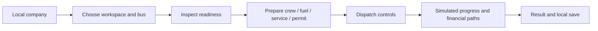

# As-Is and To-Be workflow

This is an analysis of the prototype, not a field study of Bangladesh bus operators. No claim is made about how actual businesses currently operate.

## As-Is: inspected prototype

**VERIFIED implementation inspection, E03/E09:** separate workspaces expose fleet, crew, permits, workshop, map and scenario controls. Readiness checks and persistence helpers exist. Time advancement, instant completion and offline calculations have multiple orchestration paths. Custom terminal corridors use estimates rather than a newly requested road-network route.

**VERIFIED historical limited observation, E10:** a fresh guest company could open Operations, Fleet and Business Lab in a desktop screenshot session. This did not execute the entire journey below.

The diagram describes intended connections visible in implementation, not a VERIFIED end-to-end run. **DOCUMENTED, E01:** the owner experienced confusing/broken play and refresh behavior. Root cause of each reported incident is not established by those reports alone.

## To-Be: proposed reliable loop

**PROPOSED:** choose bus and approved corridor → show all blockers with corrective actions → confirm assumptions/costs → dispatch once → progress on the same planned geometry → settle once → reconcile cash and operating result → reload unchanged company/trip.

Exceptions must be explicit: missing staff/permit, low fuel/condition, insufficient cash, road/provider failure, corrupt save and interrupted/repeated completion. A cancelled or failed operation must not pretend success. Browser storage reset must not be the normal recovery instruction.

**PROPOSED scenario flow:** choose vehicle/route → edit assumptions independently → inspect fuel/cost/revenue/break-even outputs → review uncertainty. Do not post those scenario estimates to Career cash.

## Validation gap

Readiness/save helper tests support parts of this design, not every UI connection. Full timed/instant/offline equality, live cloud isolation, mobile completion, usability and production behavior remain UNVERIFIED. [Acceptance criteria](acceptance-criteria.md) define what would count as completion.
