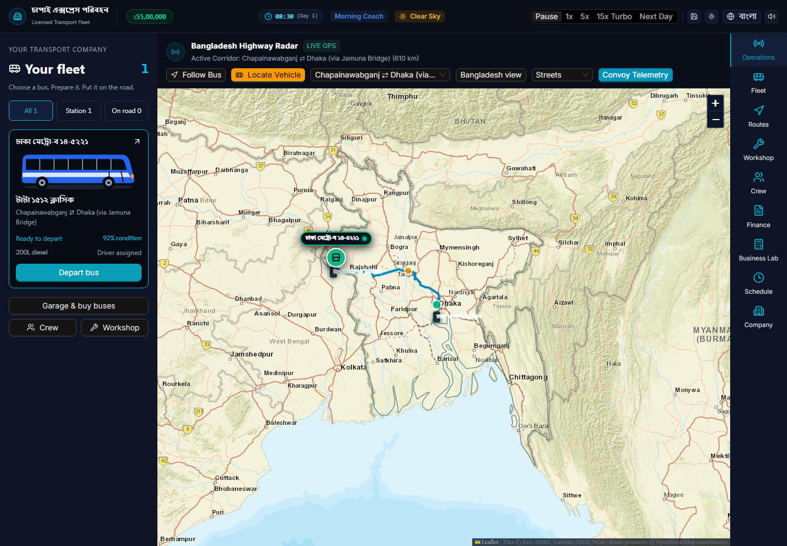
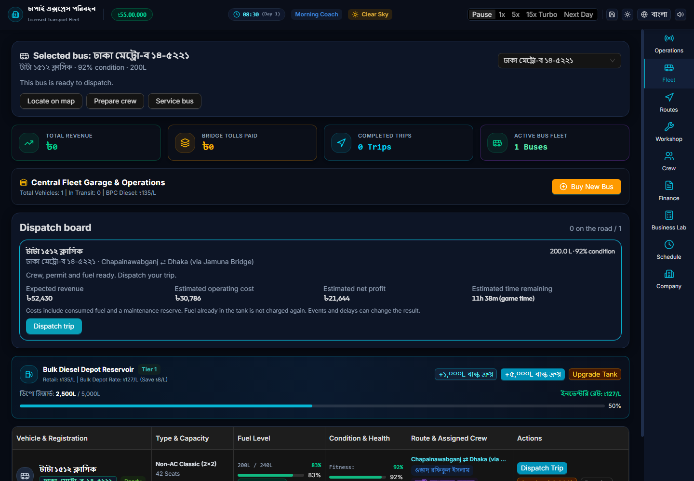
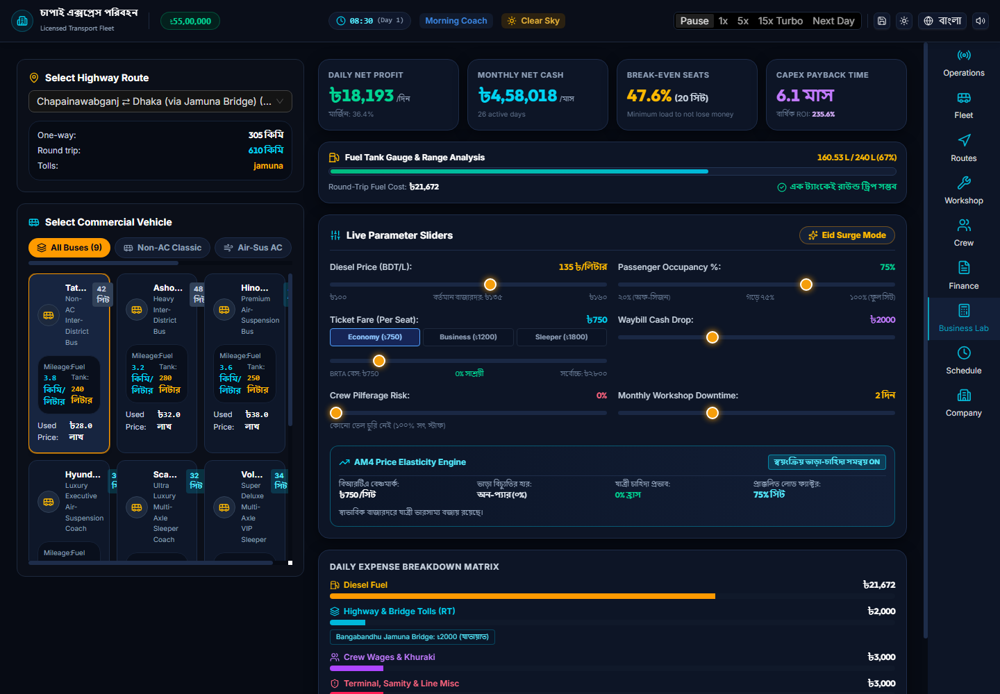

# Bengal Transport Tycoon — Project Case Study

Bangladesh-focused transport-management simulation and operating-scenario prototype. **Work in progress:** approximately one month of development, with ongoing daily work reported by the owner as of 6 November 2026. This is an AI-assisted project, not a finished multiplayer game or commercially validated feasibility service.

This repository, **transportgame-study**, contains selected documentation and actual application screenshots only. It contains no application source, database credentials, private configuration or source-repository Git history.

Setup and test commands mentioned in the reports apply to the development repository, not this documentation-only export. This repository cannot run the game by itself.

## Explore the project

- [Case study](docs/portfolio/CASE_STUDY.md): problem, discovery, decisions, contributions and lessons.
- [PRD and product-management brief](docs/portfolio/PRODUCT_BRIEF.md): users, scope, priorities and acceptance criteria.
- [Engineering report and conceptual ERD](docs/portfolio/ENGINEERING.md): inspected architecture, data relationships and limitations.
- [Testing and evidence](docs/portfolio/TESTING.md): actual checks and unresolved gates.

## Evidence, not production certification

Application baseline `326f0b8`: 454 tests across 31 files passed; production build passed. Three screenshots were captured from a real local Chrome guest session at 1440 × 1000, not generated mockups. [Capture provenance](docs/portfolio/screenshots/evidence.json) includes hashes and scope.

The screenshot session had no runtime exceptions but recorded three console error-level calls. Full dependency audit had two critical and one moderate finding; runtime-only audit reported zero. Live cloud/RLS, full gameplay, mobile/accessibility, asset rights and commercial feasibility remain unverified.

“LIVE GPS” in the screenshot is existing interface wording for simulated positions, not actual tracking. Monetary outputs are scenario/game estimates. Historical source-only references in these documents are not included in this public repository.

## Contribution and maintenance

The owner supplied the concept, Bangladesh transport context, requirements and feedback. Coding, verification and documentation were AI-assisted. No paying customers, measured efficiency gain or completed market study is claimed.

Documents are exported from an explicitly approved file list in the development repository. New files are not published automatically just because they are under `docs/`. Updating code does not automatically rewrite the case study or regenerate screenshots.

Third-party map attribution is retained. Maps, fonts, model/brand references and external assets remain subject to their owners' terms; this showcase grants no additional redistribution rights. No application deployment or source-code license is provided here.
