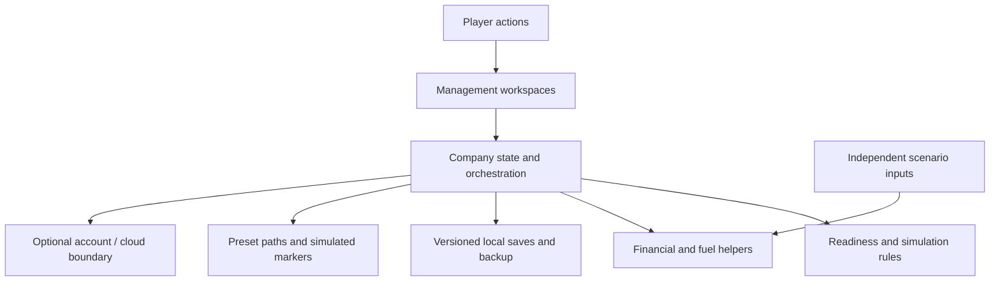
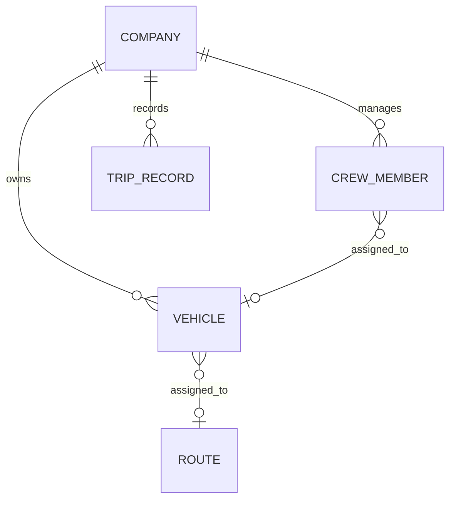

# Sanitized architecture and conceptual data relationships

**VERIFIED inspection, E03/E05–E09/E13.** The application is a browser-based React/Vite prototype with component workspaces, a central company-state layer, calculation/readiness/scheduling helpers, local persistence and an optional cloud integration. This report intentionally omits source code, internal endpoints, production schema names, private configuration and infrastructure credentials.

The diagram reflects inspected module roles, not verified security boundaries. Multiple timed/instant/day/offline paths remain; shared helper tests do not prove every live path is equivalent. **UNVERIFIED:** production cloud behavior and complete end-to-end correctness.

## Conceptual ERD

**VERIFIED inspection:** the current local model is principally a versioned company-state document with nested entities and identifier references, not a fully normalized operational database. This conceptual ERD does not claim actual SQL tables, foreign-key constraints or live access policies. Versions/slots/backups support tested local cases; they do not create server authority or unlimited history.

## Important boundaries

- **VERIFIED, E08:** initial scenario rendering does not mutate its Career-owned inputs in the inspected test. Exhaustive interaction isolation is UNVERIFIED.
- **VERIFIED, E09:** preset road geometry is distinct from approximate custom corridor construction. Neither implies live GPS, current traffic, verified tolls or bus restrictions.
- **VERIFIED inspection, E13:** cloud client and historical setup instructions disagree on the save contract. The live schema and RLS were not accessed; connectivity configuration is not an isolation test.
- **PROPOSED:** centralize financial/time transitions behind parity tests, validate untrusted data at real boundaries, and reconcile cloud ownership before advertising multi-device support. These are recommendations, not completed work.

The [decision records](engineering-decisions.md) distinguish observed choices from reconstructed rationale. The [QA report](testing-and-limitations.md) states execution limits. No application code or database was changed to write this architecture.
