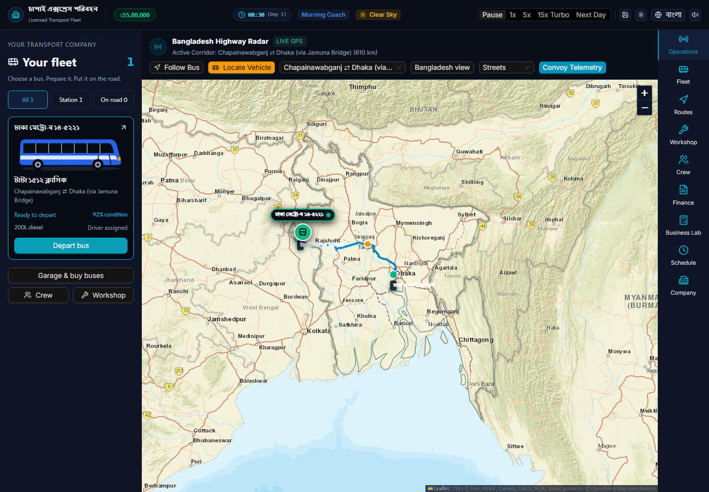

# Case study — Bengal Transport Tycoon

## Problem and discovery

**DOCUMENTED, E01/E02:** the owner wanted a Bangladesh transport-management game and a separate what-if business workspace. Owner feedback reports confusing play/refresh behavior despite a growing interface. Available discovery is the owner's brief, repository specifications, code/test inspection and sample browser evidence—not market interviews or a representative usability study.

**INFERRED:** pursuing a game and decision-support calculator together increased the need to distinguish enjoyable flow from mathematical validity. This is reconstructed analysis; original founding rationale is not independently established.

## What exists and what is proven

**VERIFIED inspection, E03:** a browser prototype has fleet, route, crew, workshop, finance, scheduling, company and scenario surfaces. **VERIFIED limited behavior, E04–E08:** selected tests cover readiness, crew independence, supported persistence and calculation/isolation assertions. These do not establish that every interface function or complete trip works.

**VERIFIED historical capture, E10:** this is an unchanged local seed-company screenshot, not an AI-generated mockup or a newly captured production session. Its “LIVE GPS” wording describes simulated position, not actual tracking. Source/data uncertainty is preserved rather than retouched out.

## Decisions, learning and limits

Browser-first guest operation, versioned local saves, preset geometry and separate scenario state are visible implementation choices. Their rationale/trade-offs are labelled reconstructed in [decision records](engineering-decisions.md); they are not invented historical meeting notes.

**DOCUMENTED contribution:** owner-led concept, domain requirements and iterative feedback; AI-assisted implementation, verification and documentation. The owner reports roughly one month of daily ongoing development as of review date. Git metadata supports the dated milestones in [timeline](development-timeline.md), not the full month or a daily streak.

**VERIFIED bounded outcome:** the project can be inspected and selected assertions can be reproduced. Current and historical QA results, including failures, are in [Testing](testing-and-limitations.md). **UNKNOWN:** paying users, measured productivity gains, commercial viability, real operating-company validation and deployed-version equivalence.

## Next meaningful validation

**PROPOSED:** prove one bus preparation-to-settlement-and-reload journey, reconcile cash/profit and terminology, then validate cloud/security/mobile behavior before expansion. More feature inventory does not replace that evidence. The [BA workstream](01-business-analysis/problem-and-context.md) and [RTM](01-business-analysis/requirements-traceability-matrix.md) show requirements, partial support and open criteria.
