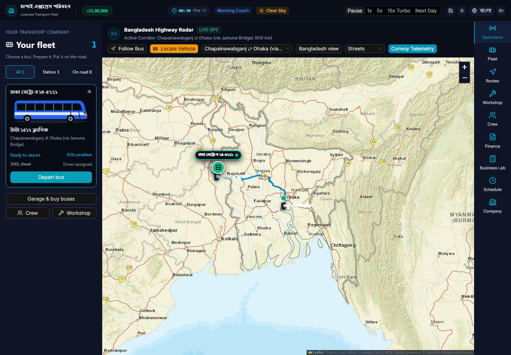

# Case study: exploring Bangladesh transport management

## Project at a glance

- **Product:** Bengal Transport Tycoon, a transport-management simulation prototype and separate Business Lab.
- **Duration:** approximately one month of development; the owner reports working on it daily and continuing development as of 6 November 2026. Exact start date and hours have not been established.
- **Version examined:** main source `326f0b8`. Recovery-branch improvements are not included.
- **Contribution:** owner-led concept, domain requirements, scope decisions and iterative feedback; AI-assisted coding, debugging, tests and documentation.
- **Stage:** work in progress. No commercial traction, external user-study results or complete production-readiness claim.

## Problem

The owner wanted to connect a tycoon-style management game with Bangladesh transport-business decisions: preparing a bus, assigning a route and crew, dispatching, observing a trip and understanding its costs. A parallel scenario workspace would help explore how fares, occupancy, fuel and investment affect an operation.

Two products were effectively being pursued together: an enjoyable management simulation and a reliable decision-support calculator. Their correctness and user-experience requirements are different. A convincing animated map does not validate economics; a spreadsheet-like result does not establish a good game loop.

## Discovery and research method

The available discovery material is the owner's transport-domain brief, repeated interface feedback, repository specifications and the data/calculation notes (source-only reference). This case study was grounded in current source inspection, automated tests, a production build and real browser screenshots.

That is desk/source inspection and prototype evaluation—not a completed market survey. No interviews with operators, validated current vendor quotations, representative demand dataset, controlled usability study or independent transport-accounting audit were established in this task. Historical/source-linked values remain assumptions until separately verified.

## What was built

The interface contains Operations, Fleet, Routes, Workshop, Crew, Finance, Business Lab, Schedule and Company workspaces. Modules cover fleet readiness, permits, purchase, fuel, crew, trip calculations and local persistence. The Business Lab exposes adjustable parameters and operating projections.

This is a real paused guest-company screenshot, not a design mockup. “LIVE GPS” remains visible in the interface but describes simulated movement, not a real tracking integration. The screenshot deliberately preserves the current wording rather than disguising an unresolved issue.

## Engineering decisions and trade-offs

| Decision visible in the implementation | Benefit | Cost or unresolved risk |
| --- | --- | --- |
| Browser-first React/Vite prototype | Easy local startup; guest company without cloud credentials | Main state hook contains many responsibilities and duplicated transition paths |
| Local versioned JSON saves with slot backup helpers | Company persistence and tested migration/corruption cases | Browser storage is not a multiplayer authority or complete corruption guarantee |
| Leaflet map and bundled preset road geometries | Readable geographic context and simulated route movement | Generic preset geometry and heuristic custom corridors are not bus-safe navigation |
| Separate Business Lab component state | Experiment without directly changing the owned Career company | Financial parity across Career and Lab is not yet established |
| Optional Supabase integration | Existing path toward account-based saves | Client/schema mismatch and unverified RLS prevent a supported cloud claim |

The documentation work preserves this main version. It does not silently merge recovery code, redesign the interface or turn estimates into verified real-world numbers.

## Outcomes supported by evidence

On 6 November 2026, the current main source passed **454 tests across 31 files** and built successfully. The screenshot session navigated Operations, Fleet and Business Lab at 1440 × 1000 without a runtime exception or desktop horizontal overflow. It recorded **three console error-level entries**; those remain unresolved in this bounded task.

These checks demonstrate specific local behavior, not that every function is correct or the game is enjoyable. The owner has reported broken/confusing flows. That feedback remains valid even while unit tests pass. See [Testing](TESTING.md) for commands, scope and missing checks.

## Lessons from the development process

1. Prove one complete management loop before expanding the feature inventory: choose bus → prepare → dispatch → complete → reconcile → reload.
2. Keep user-facing labels as honest as calculations. “Live,” “official” and “cash” require specific evidence.
3. Separate operating results, cash transactions, road geometry and permit authorization instead of treating them as interchangeable.
4. Maintain a clear version boundary. Documentation about another branch cannot certify the version a reviewer is running.
5. Use AI assistance as an implementation tool, not a substitute for understanding core formulas, reading code or testing the actual user journey.

## Next validation

The next useful outcome is a small repeatable trip demonstration and accounting reconciliation, followed by reload and second-device/security verification only when the first loop is stable. No savings percentage, ROI improvement, user count or completed research milestone is invented for this portfolio.

Related: [Product brief and PM priorities](PRODUCT_BRIEF.md), [engineering/data model](ENGINEERING.md), [README](../../README.md).
