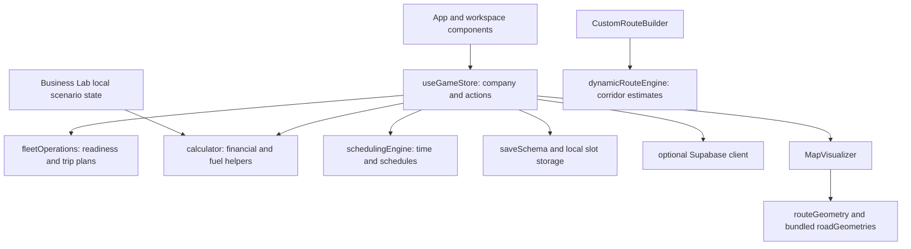
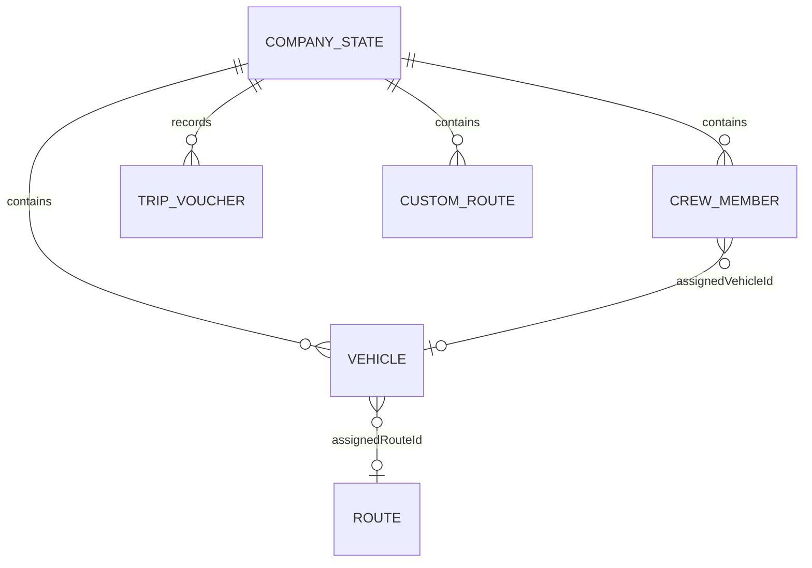

# Engineering report and data relationships

Inspected baseline: `326f0b8` on main, 6 November 2026. This document describes the application as it exists, not an implemented replacement architecture. No production database was accessed or migrated for this report.

## Stack and boundaries

React 19 with Vite; Ant Design 6, Tailwind CSS 4 and custom styles; Lucide icons; imperative Leaflet; optional Supabase JavaScript client. JavaScript modules contain the simulation and calculation helpers. Vitest runs the automated tests. Browser evidence uses the existing Chrome DevTools Protocol convention without adding a browser-testing dependency.

The store still contains separate dispatch, ticking, instant/day advancement and offline-earnings paths. The presence of shared helper functions does not mean every live transition uses one canonical settlement engine. The recovery branch contains different implementation work; none is treated as part of this baseline.

## Data model / conceptual ERD

The local primary format is a JSON save envelope, **not** the normalized relational tables suggested by a full transport ERP design. The following diagram describes conceptual relationships within that JSON and referenced preset data:

`ownedPermits` stores route identifiers. Routes combine preset data with custom entries. Crew members are grouped by role. Fleet records contain status, condition, fuel, assigned route and trip progress. The diagram is explanatory; it does not assert enforced foreign keys in browser storage.

The envelope includes `schemaVersion`, `saveId`, `slotId`, owner metadata, revision/timestamps and `state`. Current schema version is 5. Per-slot keys use `bengal_transport_tycoon_save_v5_<slotId>` and `bengal_transport_tycoon_backup_v5_<slotId>`. Selected legacy keys can be migrated. A same-slot previous valid envelope is a backup, not an unlimited revision history.

Storage parsing, numeric repair and backup handling have focused tests. Preserve corrupt evidence when both candidates fail; do not recommend clearing user storage as the normal recovery path. Local saves are editable by users and must not become a trusted multiplayer ledger.

## Simulation versus financial analysis

- `fleetOperations.js` provides readiness/assignment guards and a Career trip-plan helper.
- `calculator.js` provides fuel, revenue, operating cost, financial summary, break-even, demand assumptions and checkpoint/voucher helpers.
- `gameStore.js` owns the large live orchestration hook, including costs, scheduled actions, event handling, progress and save integration.
- `SandboxCalculator.jsx` uses its own scenario inputs and calculation helpers. Its unit render test checks that Career-owned inputs are not mutated.

Operating profit and cash balance are distinct concepts. Existing UI/report wording and duplicated paths require reconciliation; this report does not claim all paths are financially equivalent. Demand elasticity, weather effects, maintenance and other coefficients are simulation/scenario assumptions unless separately evidenced.

## Mapping and routing

Bundled preset geometries identify OSRM/OpenStreetMap as their source. Leaflet draws those paths and simulated vehicle positions. Main's custom route builder instead calls `buildDynamicRoute`, which estimates corridor distance and bridges; it does not request a current road-network path when the user creates a route.

Map tiles and route geometry are different dependencies. A displayed street map does not prove the selected corridor follows those streets, supports bus restrictions or knows current traffic. Permit scope, road path, legal navigation and live location must remain separate claims.

## Optional cloud integration

`src/services/supabase.js` creates a client from `VITE_SUPABASE_URL` and `VITE_SUPABASE_ANON_KEY` when configured. Save upsert fields target `player_saves`: `user_id`, `company_name`, `game_day`, `cash_balance`, `fleet_count`, `save_state_json`, `updated_at`; load selects `save_state_json` by user ID.

Historical setup SQL (source-only reference) defines `player_empires` with a different shape. That is a contract mismatch, not proof of cloud functionality. Live schema, RLS policies, auth isolation, concurrent device writes and conflict resolution were not inspected against a real database.

Browser-exposed publishable/anon credentials are not service-role secrets. Correct RLS is necessary. Private database connection strings, service-role keys and personal saves must never appear in source, screenshots or public reports. This documentation task did not use database credentials or inspect a personal browser session.

## Engineering risks and deferred work

1. Multiple money/time transition paths can drift; consolidate only with parity and replay tests.
2. Main's offline summary/claim behavior remains present. It differs from the recovery branch and was not certified by the screenshot session.
3. A large state hook increases review and regression cost. Prefer small extraction behind tests over a rewrite.
4. Dependency audit has open critical development-tree findings. Runtime-only zero findings does not establish security.
5. Full accessibility, mobile, Web Vitals, long-run stress validity, input/HTML boundary audit, clean installation and asset-licensing gates remain open.

No APIs, database schema, dependencies or application behavior were changed to create this documentation. See [Testing](TESTING.md) for the actual verification scope and [Product brief](PRODUCT_BRIEF.md) for ordered future work.
